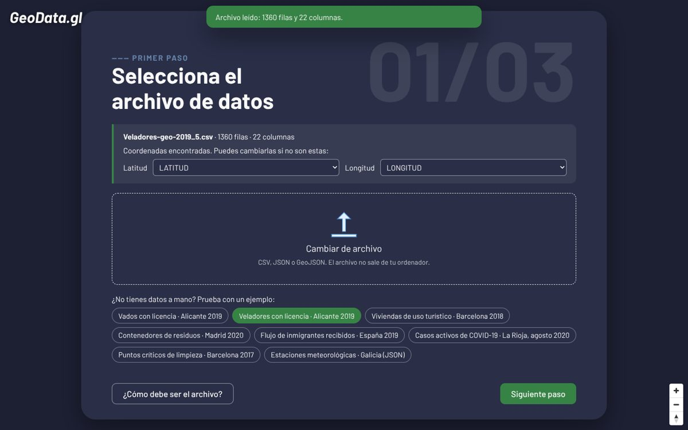
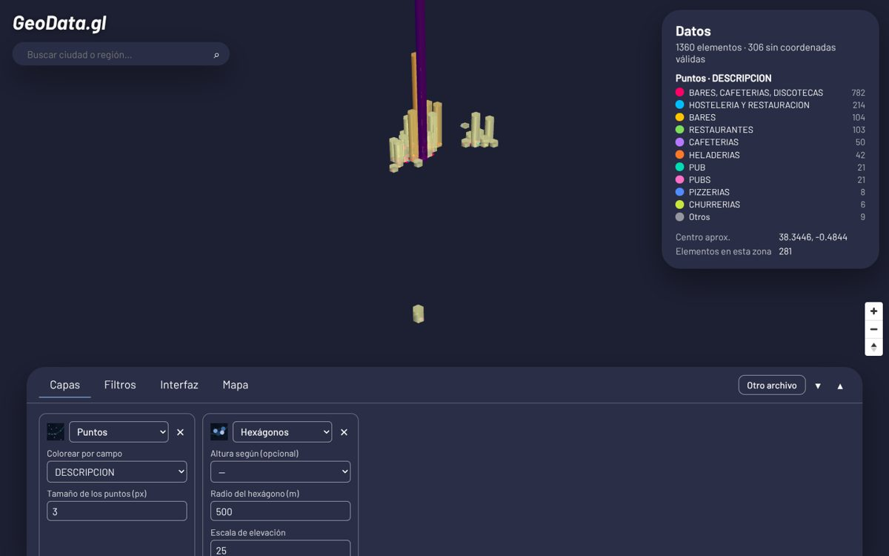
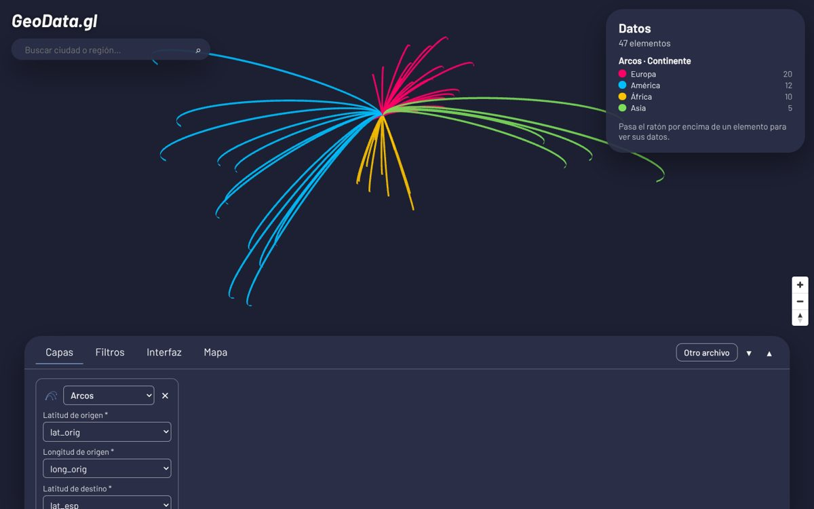

# GeoData.gl

Web app para representar en un mapa datos geolocalizados a partir de archivos **CSV, JSON o GeoJSON**, con capas 2D y 3D. Funciona entera en el navegador: el archivo no se sube a ningún servidor.

Es mi Trabajo de Fin de Grado en Ingeniería Multimedia (Universidad de Alicante). En 2026 lo he puesto al día y he rehecho su arquitectura (ver [Qué ha cambiado](#qué-ha-cambiado-en-la-versión-2)).

**[Probar la demo](https://md6-0.github.io/TFG-GeoData.gl/)** · [Abrir un ejemplo directamente](https://md6-0.github.io/TFG-GeoData.gl/webapp.html?ejemplo=flujo_migratorio.csv)

| Asistente | Hexágonos 3D | Arcos |
| --- | --- | --- |
|  |  |  |

## Qué hace

- **Asistente en tres pasos**: archivo → representaciones → tema del mapa.
- **Detecta solo las columnas de latitud y longitud** (por nombre y comprobando que los valores estén en rango). Si no las encuentra, te deja elegirlas.
- **Seis tipos de capa**, combinables: puntos, chinchetas, mapa de calor, mapa de calor 3D, hexágonos 3D y arcos origen-destino.
- **Colores por categoría** con leyenda (los valores más frecuentes se llevan los colores; el resto, «Otros»).
- **Filtros** por rango (números) o por texto, aplicados al momento.
- **Caja de datos** con la información del elemento bajo el ratón y los campos que elijas.
- **Seis temas de mapa libres**, sin claves ni cuentas: satélite, estándar, relieve, día, noche y oscuro.
- **Buscador de lugares** (OpenStreetMap).
- **Ocho conjuntos de datos abiertos de ejemplo** que se abren con un clic.

## Tecnologías

[deck.gl 9](https://deck.gl) para las capas de datos (WebGL) · [MapLibre GL](https://maplibre.org) para el mapa base · [OpenFreeMap](https://openfreemap.org), Esri World Imagery y OpenTopoMap para las teselas · [Papa Parse](https://www.papaparse.com) para leer CSV · [Vite](https://vite.dev) · [Vitest](https://vitest.dev) · JavaScript sin framework.

## Ponerlo en marcha

Necesita Node 20 o posterior.

```bash
npm install
npm run dev       # servidor de desarrollo en http://localhost:5173
npm run check     # lint + tests + build
npm run build     # genera dist/
```

Al subir a `main`, la action `.github/workflows/pages.yml` comprueba el proyecto y publica `dist/` en GitHub Pages.

## Arquitectura

```
index.html, webapp.html, datos.html   páginas (Vite multipágina)
src/
  app/
    main.js        arranque: conecta estado, mapa e interfaz
    estado.js      estado central con suscripciones (observar)
    acciones.js    todos los cambios de estado pasan por aquí
  datos/           sin DOM; se prueba con tests
    parsear.js     CSV / JSON / GeoJSON → filas
    columnas.js    tipos de columna, normalización, latitud/longitud y arcos
    filtros.js     filtros por rango y por texto
    procesar.js    todo lo anterior junto
    procesar.worker.js, cargar.js   la lectura se hace en un Web Worker
    ejemplos.js    archivos de ejemplo
  capas/
    registro.js    lista de tipos de capa
    puntos.js, chinchetas.js, calor.js, calor3d.js, hexagonos.js, arcos.js
    comun.js       forma de un tipo de capa y utilidades compartidas
    colores.js     escala de colores por categoría
    construir.js   estado → capas de deck.gl
  mapa/
    mapa.js        MapLibre + overlay de deck.gl
    temas.js       estilos de mapa libres
  ui/              asistente, menú, paneles, caja de datos, buscador, avisos
    dom.js         h(): crea nodos sin innerHTML
tests/             Vitest
public/            iconos, imágenes y datos de ejemplo
```

El flujo es siempre el mismo: **la interfaz llama a una acción → la acción cambia el estado → quien observa esa parte del estado se actualiza** (el mapa reconstruye sus capas, un panel se vuelve a dibujar…). Ninguna parte de la interfaz toca el mapa ni las demás partes directamente.

**Añadir un tipo de capa** es escribir un módulo en `src/capas/` con `id`, `nombre`, `icono`, `opciones` y `crear(ctx)`, y añadirlo a `registro.js`. El asistente y el panel de capas lo recogen solos, porque el formulario de cada capa se genera a partir de sus `opciones`.

## Qué ha cambiado en la versión 2

La primera versión era un MVP que fue creciendo sin cambiar su estructura: un único `webapp.js` de 1.570 líneas con unas 20 variables globales y una interfaz que dependía de posiciones del DOM (`children[13]`) y de clases CSS como «0» o «-2». Con la entrega a la vista, era lo que había. Ahora:

**Herramientas**
- Webpack 4 → Vite. Ya no se suben los bundles compilados (4,4 MB) al repositorio.
- mapbox-gl 1 (token y estilos de una cuenta) → MapLibre con mapas libres que no necesitan clave.
- deck.gl 8 con `MapboxLayer` (quitando y poniendo capas a mano en cada cambio) → deck.gl 9 con `MapboxOverlay` y capas declarativas.
- Toastify desde un CDN sin versión → avisos propios. Sin dependencias cargadas desde CDN.
- Lectura de archivos en un Web Worker: un CSV de 50.000 filas ya no congela la página.

**Errores corregidos**
- Los colores por categoría se identificaban sumando los códigos de las letras («AC» y «BB» salían del mismo color) y eran aleatorios en cada filtrado.
- El tipo de cada columna (número/texto) se decidía mirando solo la primera fila, y el de todos los filtros, mirando solo la primera columna.
- La comprobación de los campos de los arcos usaba el operador coma y solo miraba el último.
- Los desplegables empezaban por «undefined», y al cargar un segundo archivo se acumulaban los campos del anterior.
- Los nombres de columna con espacios rompían los desplegables.
- Los valores del archivo se metían en la página con `innerHTML` (ahora el lint lo prohíbe).
- Las filas sin coordenadas o en 0,0 se dibujaban en mitad del Atlántico. Ahora se descartan y la app dice cuántas son (en `vadosALC.csv` son 1.797 de 6.525).
- El mapa se centraba en la primera fila del archivo; ahora se encuadran todos los datos.

**Mejoras**
- Arrastrar y soltar el archivo (antes el texto lo decía, pero no funcionaba), GeoJSON, más separadores de CSV y coma decimal.
- Las seis capas, incluidos hexágonos y arcos, se pueden elegir en el asistente; para los arcos se proponen solas las columnas de origen y destino.
- Leyenda de colores, peso opcional en el mapa de calor y altura opcional en los hexágonos (antes obligatoria).
- Filtros de texto por «contiene», sin distinguir mayúsculas ni tildes.
- Ejemplos que se abren con un clic desde el asistente o desde la página de datos.
- Diseño adaptado a móvil, foco de teclado visible y pestañas y botones accesibles.
- 35 tests y lint.

## Datos de ejemplo

Proceden de portales de datos abiertos (Ayuntamientos de Barcelona, Madrid y Alicante, Gobierno de La Rioja, INE, MeteoGalicia). Las fuentes están en la página «Datos de ejemplo».

## Licencia

Código bajo [GPL-2.0](LICENSE). Tipografía Barlow bajo la SIL Open Font License (`src/assets/fonts/OFL.txt`). Mapas © OpenStreetMap contributors, OpenFreeMap, Esri y OpenTopoMap, como se indica en la atribución del propio mapa.
